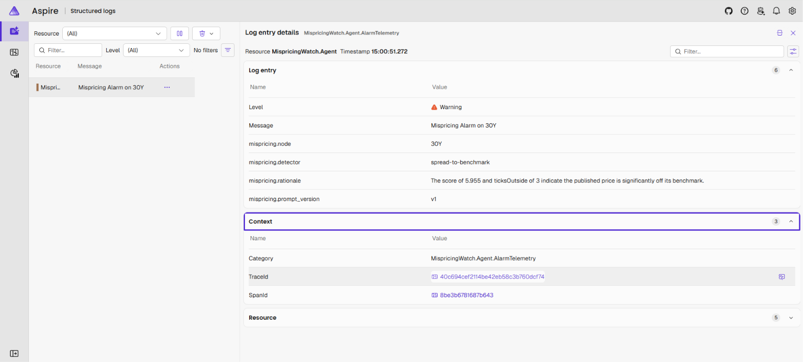
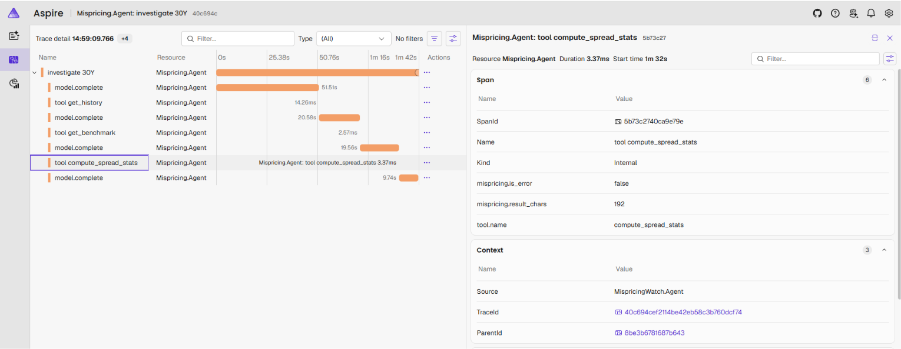

<div align="center">

# Mispricing Watch

### Is this published price real, or is our pricing system wrong?


</div>

A C# agent built as an MCP server (tool producer) plus a hand-written agent loop (tool orchestrator). Companion to [claude-mcp-flaky-test-agent](https://github.com/bleunguts/claude-mcp-flaky-test-agent), applied to yield-curve pricing. Built as an incremental tutorial: concept first, then code, one small session at a time.

---

<p align="center">
  
</p>

<sub>The image is rendered from [`docs/overview.html`](./docs/overview.html). Plan, requirements and open questions are in [`ROADMAP.md`](./ROADMAP.md).</sub>

## 📚 Docs

| File | What is in it |
|---|---|
| [`ROADMAP.md`](./ROADMAP.md) | Purpose, intended narrative, requirements, how the agent decides, MVP scope, phases, open questions. |
| [`CLAUDE.md`](./CLAUDE.md) | Working rules and session log. |

Source layout: `src/MispricingWatch.CurveLab` (simulator library), `src/MispricingWatch.McpServer` (tool producer), `src/MispricingWatch.Agent` (tool orchestrator: hand-written loop, local Qwen, alarm telemetry). Tests are in `tests/`; the scorecard that reads the hidden answer key is `SecretGroundTruthScoreTests`.

## 🔔 See an alarm and its trace in the dashboard

The agent sends two OpenTelemetry signals. When it decides a price is wrong it emits the alarm as a **log record**, and every investigation is recorded as a **trace**: one span per model call and per tool call. Any OTLP viewer can show them; the [Aspire dashboard](https://aspire.dev/dashboard/standalone/) is the easiest, needs no Docker, and runs locally.

<p align="center">
  
</p>

<p align="center">
  
</p>

One-off setup (installs the Aspire CLI as a global .NET tool):

```bash
dotnet tool install -g Aspire.Cli
```

Then, in one terminal, start the dashboard. It prints a login link and listens for telemetry on `localhost:4317`:

```bash
aspire dashboard run
```

In a second terminal, run the agent on the 30Y node, which has a real gap to its benchmark (needs [Ollama](https://ollama.com) with `qwen2.5:7b` pulled, and the solution built):

```bash
dotnet run --project src/MispricingWatch.Agent -- live qwen2.5:7b 30Y
```

Open the dashboard link. In **Structured logs** you will see the alarm. Only alarms are logged, so a clean node such as 10Y shows no alarm. Each record carries `mispricing.node`, `mispricing.detector`, `mispricing.rationale` and `mispricing.prompt_version`, and its TraceId links to the investigation behind it. In **Traces**, every run appears as one trace: the root span `investigate 30Y` with a child span per model call and per tool call, with timings. In the screenshot the run takes about 100 seconds, almost all of it the local model thinking; the three tool calls take milliseconds. Spans carry sizes only (for example `mispricing.result_chars`), never prompt or result text. The agent also prints the alarm to its own console. To send telemetry to another viewer, set `OTEL_EXPORTER_OTLP_ENDPOINT`.
